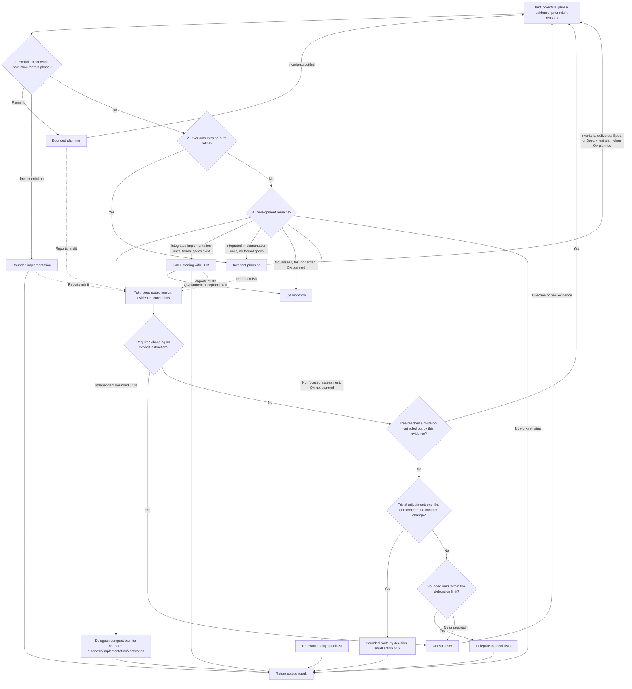

# Workflow selection

Before a planning or implementation phase starts, Takt walks one decision tree and adopts the
route it reaches. Only the adopted route's skill is loaded; no other workflow is loaded to
help decide. The adopted route owns its internal rules, including the signals that show it
does not fit. When one appears, control returns to the tree with that evidence.

## Decision tree

| Step | Question | Answer → outcome |
| --- | --- | --- |
| 1 | Did the user directly and explicitly request direct work for this phase? | Planning without specialists → `takt-bounded-planning`. Implementation without delegation → `takt-bounded-workflow`. No → step 2. |
| 2 | Are required invariants missing or in need of refinement? | Yes → `takt-invariant-planning`; once invariants are delivered, back to step 1 with the updated evidence. Invariant planning stands on its own; when SDD follows it, its specifications, and its test plan when QA is planned, feed TPM, SDD's first node. QA is planned only when acceptance needs the QA workflow rather than individual quality specialists (`PR-QA-4`); its test plan and traceability matrix are then required invariants. No → step 3. |
| 3 | Is development still needed? | Independent bounded units → delegate within the cumulative unplanned limit; bounded diagnosis, implementation and verification use a compact plan (`PR-ORQ-20`). Integrated implementation units → `takt-sdd-workflow` with formal, broken-down specifications (Engram or equivalent repository artifact); without them → step 2. Its acceptance tail uses `takt-qa-workflow` when QA is planned. Assessment, testing or hardening → QA workflow if planned, otherwise the relevant quality specialist. Nothing remains → return the result. |

Respect stated scope: task-wide no-delegation includes verification; phase-only orders do not
extend to others. A generic implementation request is not a direct-work order (`PR-ORQ-30`).
Judge QA against the whole objective under `PR-QA-4`, consulting QA when unclear; a focused
review alone does not activate it. Keep committed checks; findings authorize neither repair nor certification.

Settled invariants are consumed, never regenerated; settledness is judged by title and relations, and the consumer checks the
repository. No text outside this tree requires a workflow. Bounded is never chosen by elimination, convenience, cost, or absence of
specialists. SDD and bounded never govern the same implementation simultaneously.

## Return from an adopted route

| Situation | Outcome |
| --- | --- |
| The adopted route reports, with evidence, that it does not fit | Back to step 1 with the reason, evidence, and constraints; the same route is never re-adopted under identical evidence. |
| The tree leads only to routes that already reported a misfit, and the adjustment is trivial: one file, one concern, and no contract or interface change or other lane's judgment | Takt adopts the phase's bounded route by decision, limited to that small action. |
| Same, not trivial, and the work is bounded units within the unplanned-delegation limit | Delegation to the needed specialists; a single planning specialty still goes to its specialist. |
| Uncertainty persists, nothing fits, or proceeding requires changing an explicit user instruction | Takt consults the user with evidence and alternatives and waits for direction. |

## Diagram

The diagram visualizes the tables above; the tables are normative.

